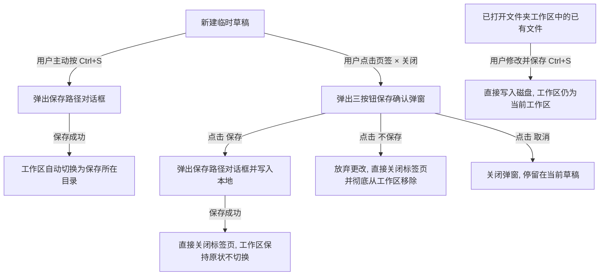

# 极简 Windows 桌面 Markdown 编辑查看器 (MiniMark) - 完整产品需求文档 (PRD)

> **版本号**：v1.0.0 Release / PRD v2.8 (完整版 / Full Specification)  
> **面向平台**：Windows 10 / Windows 11 桌面端 (64-bit)  
> **运行环境**：独立绿色可执行文件 `MiniMark.exe` (内嵌 PySide6 6.9+ & Chromium 内核)  
> **文档性质**：全量产品需求文档与设计规范（含全版本历史迭代记录）

---

## 1. 产品概述与核心定位

### 1.1 产品愿景
打造一款**极简、优雅、轻量、秒级启动**的 Windows 桌面级 Markdown 编辑与查看工具。借鉴 **Typora 纯净排版美学**，彻底摒弃繁复冗余的工具栏干扰，让用户沉浸于纯粹的书写与高质量的内容阅读。

### 1.2 核心设计哲学
- **独立应用，无黑框命令行**：构建为纯正的 Windows GUI 独立桌面程序，双击即开，无需任何外部运行环境依赖。
- **极简无干扰 (Distraction-Free)**：呼吸感留白，全局采用 1.5px 纤细矢量 SVG 线条图标，界面元素克制优雅。
- **即开即用 (Instant & Lightweight)**：前端核心渲染库 100% 离线本地化，零网络请求延迟，冷启动耗时极低。
- **全页签关闭优雅回退主页 (Home Dashboard)**：关闭所有标签页时不强制弹出无用草稿，而是展示沉浸式主页，一键访问最近文件夹与最近文件。
- **未保存数据安全防御 (Unsaved Changes Guard)**：关闭未保存页签时弹出包含【取消】、【不保存】、【保存】的三按钮模态弹窗；选择【不保存】时继续关闭并彻底从工作区清除该临时草稿。
- **精准的工作区流转规则 (Workspace Scope Rules)**：
  1. **仅用户主动保存临时文件 (`Ctrl+S`)**：工作区才自动切换为该文件保存的目录。
  2. **关闭页签弹窗中点击【保存】**：文件写入本地后直接关闭页签，**工作区保持原状，不进行切换**。
  3. **在已打开的文件夹中修改文件并保存**：**工作区始终保持为当前已打开的工作区**，不发生任何切换。
- **三种视窗灵活流转**：右上角半透明磨砂悬浮胶囊自由切换「仅查看 👁」、「双栏对照 ◫」、「仅编辑 ✎」。
- **深度系统融入**：自动跟随 Windows 系统深浅色主题切换，支持中英双语无缝切换。

---

## 2. 完整功能需求矩阵 (PRD Matrix)

| 模块分类 | 需求编号 | 需求项 | 详细规范与交互定义 | 优先级 |
| :--- | :--- | :--- | :--- | :--- |
| **独立打包发布** | REQ-PKG-01 | **独立 GUI 可执行文件** | 生成纯正无黑框 Windows 64-bit 独立可执行程序 `MiniMark.exe`，内置专属高清多尺寸应用图标。 | P0 |
| | REQ-PKG-02 | **版本与版权信息** | 内嵌元数据：版本 `1.0.0`，作者/公司 `MizukiRin`，版权 `Copyright (C) 2026 MizukiRin`。 | P0 |
| **工作区精准流转** | REQ-WS-01 | **主动保存临时文件切换工作区** | 仅当用户在临时草稿中**主动按下 `Ctrl+S` / `Ctrl+Shift+S` 或点击顶栏保存**时，保存后工作区才自动切换加载为保存所在的文件夹目录。 | P0 |
| | REQ-WS-02 | **关闭页签弹窗保存不切换工作区** | 用户点击页签 `×` 触发未保存弹窗并选择【保存】时，文件成功保存后直接关闭页签，**工作区不切换为保存目录，保持原状**。 | P0 |
| | REQ-WS-03 | **已有工作区内修改保存不切换** | 用户在已打开的工作区文件夹中打开文件、编辑并保存时，**工作区始终保持为当前已打开的工作区**，不发生重新加载或跳转。 | P0 |
| **未保存防丢失** | REQ-SV-01 | **三按钮未保存确认弹窗** | 关闭已修改或存在内容的未保存页签时，弹出模态弹窗，提示：`文件 "xxx" 尚未保存，是否在关闭前保存更改？`。 | P0 |
| | REQ-SV-02 | **【取消】交互** | 点击【取消】（或按 `Esc` 键）：取消关闭操作，模态弹窗消失，停留在当前文档标签页。 | P0 |
| | REQ-SV-03 | **【不保存】交互** | 点击【不保存】：放弃当前文档所有修改，**直接关闭该标签页，并彻底将其从工作区目录树中移除**；若页签全关则平滑退回主页。 | P0 |
| | REQ-SV-04 | **【保存】交互** | 点击【保存】：弹出系统文件保存路径选择对话框，写入磁盘成功后关闭该标签页，不变更工作区。 | P0 |
| **主页与空状态** | REQ-HM-01 | **无页签主页 Dashboard** | 当用户关闭所有标签页后，**不再默认新建临时文件**，主视窗自动切换展示应用主页 Dashboard。 | P0 |
| | REQ-HM-02 | **主页核心元素** | 主页居中展示应用品牌名称、副标题、三大快捷操作按钮（【新建文件】、【打开文件夹】、【打开文件】）。 | P0 |
| | REQ-HM-03 | **最近打开记录展示** | 左右分栏卡片展示「最近打开的文件夹」与「最近打开的文件」，支持点击秒级直达打开并持久化存储（`localStorage`）。 | P0 |
| **主题与多语言** | REQ-TH-01 | **深浅色主题跟随** | 自动读取 Windows 注册表主题配置，系统在浅色/深色切换时应用毫秒级即时响应；支持手动一键覆盖切换。 | P0 |
| | REQ-TH-02 | **中英双语 (i18n)** | 完整支持简体中文 (`zh-CN`) 与英文 (`en-US`)，所有按钮、提示、右键菜单、状态栏实时本地化。 | P0 |
| **工作区与文件管理** | REQ-FS-01 | **打开工作区文件夹** | 快捷键 `Ctrl+K Ctrl+O`，递归解析加载文件夹目录树，支持无限层级展开/折叠与状态记忆。 | P0 |
| | REQ-FS-02 | **工作区集成打开单文件** | 统一在左侧工作区工具栏与空状态提供打开文件入口 (`Ctrl+O`)，去除顶栏多余按钮。 | P0 |
| | REQ-FS-03 | **新建临时文件机制** | 点击新建 (`Ctrl+N` / `＋`) 立即在工作区置顶生成带有 `[临时]` 标签的草稿项，**默认自动进入【仅编辑模式】并聚焦输入光标**。 | P0 |
| | REQ-FS-04 | **临时草稿分割线** | 当工作区同时存在临时草稿与正式文件夹目录树时，在两者中间呈现一条**极简浅色横线分割**。 | P0 |
| | REQ-FS-05 | **多标签页 (Tabs)** | 顶部支持打开多个文件标签页，支持切换、关闭、未保存圆点脏状态 (`*`) 提醒及关闭防丢失确认。 | P0 |
| | REQ-FS-06 | **格式拦截与友好提示** | 仅支持打开 Markdown 及文本文件 (`.md`, `.markdown`, `.txt`)；点击其他文件通过 Toast 友好拦截。 | P1 |
| | REQ-FS-07 | **像素级对齐目录树** | 严格规范文件与目录槽位（占位符、Chevron、文件图标、文件名），杜绝任何视觉参差不齐与偏移。 | P0 |
| | REQ-FS-08 | **右键上下文菜单** | 支持在工作区右键快速执行：新建文件、在 Windows 资源管理器中打开高亮、安全删除。 | P1 |
| **视图与视窗布局** | REQ-VW-01 | **右上角悬浮模式胶囊** | 主视图右上角常驻磨砂半透明胶囊，点击/悬停平滑展开 `[ ✎ 仅编辑 | ◫ 双栏 | 👁 仅查看 ]`。 | P0 |
| | REQ-VW-02 | **仅查看模式 (默认)** | 默认打开已有文件时呈现 Typora 级纯净排版视图，隐藏源码编辑区，沉浸阅读。 | P0 |
| | REQ-VW-03 | **仅编辑模式** | 全宽源码编辑区，支持等宽代码字体、自动折行、Tab 缩进与快捷键。 | P0 |
| | REQ-VW-04 | **双栏对照与同步滚动** | 左侧源码编辑，右侧实时渲染；左/右滚动时以精准比例驱动对侧联动滚动，防止死循环。 | P0 |
| | REQ-VW-05 | **侧边栏折叠** | 快捷键 `Ctrl+B` 或顶栏图标展开/折叠侧边栏，最大化编辑与阅读空间。 | P1 |
| **Markdown 渲染引擎** | REQ-MD-01 | **GFM 现代排版规范** | 标题 H1-H6、列表、引用块、表格、图片、超链接、粗斜体、删除线。 | P0 |
| | REQ-MD-02 | **KaTeX 数学公式** | 原生支持行内公式 `$E=mc^2$` 与块级高精度公式 `$$\int_{-\infty}^{+\infty} e^{-x^2} dx = \sqrt{\pi}$$`。 | P0 |
| | REQ-MD-03 | **Mermaid.js 图表** | 原生支持 ````mermaid ... ```` 流程图、时序图、甘特图、类图实时渲染。 | P0 |
| | REQ-MD-04 | **Prism 代码高亮与复制** | 支持 Python, JS, JSON, Bash, Markdown 等常见语言语法高亮，代码块右上角内置一键复制按钮。 | P0 |
| | REQ-MD-05 | **交互式复选框清单** | 在预览区直接点击 `- [ ]` / `- [x]` 任务复选框，自动双向回写并更新源码。 | P1 |
| **搜索与替换引擎** | REQ-SR-01 | **精准黄色全文高亮** | `Ctrl+F` 唤出搜索栏，文档内所有匹配项自动包裹 `<mark>` 标签黄色高亮。 | P0 |
| | REQ-SR-02 | **焦点高亮与居中滚动** | 当前激活匹配项橙色加重高亮，并自动触发 `scrollIntoView` 平滑滚动对齐至视窗正中心。 | P0 |
| | REQ-SR-03 | **上一个 / 下一个导航** | 支持按钮点击及 `Enter` (下一个) / `Shift+Enter` (上一个) 循环导航，实时展示 `当前/总数` (如 `3/12`)。 | P0 |
| | REQ-SR-04 | **查找与替换 (Ctrl+H)** | 支持单个替换及全部替换，同步更新源码并自动刷新高亮。 | P1 |

---

## 3. UI/UX 界面原型与视觉设计规范

### 3.1 工作区流转状态机 (State Machine)



### 3.2 目录树像素级对齐规范 (Tree Alignment Spec)
目录树每一行均采用固定槽位体系：
```
[ 14px 展开箭头/占位槽 ] + [ 6px 间隙 ] + [ 15px 文件/文件夹图标槽 ] + [ 6px 间隙 ] + [ 弹性文本节点 ] + [ 临时状态标签 ]
```

### 3.3 视觉色彩体系 (Typora Theme Specification)

| 视觉元素 | 浅色模式 (Light Theme) | 深色模式 (Dark Theme) |
| :--- | :--- | :--- |
| **应用背景 (App BG)** | `#FFFFFF` (纯净素白) | `#1E1E1E` (深邃黑灰) |
| **侧边栏背景 (Sidebar BG)** | `#F8F9FA` (轻微灰度分界) | `#252526` |
| **文字主色 (Text Main)** | `#24292E` (高对比度炭黑) | `#D4D4D4` |
| **强调主色 (Primary)** | `#0366D6` (科技极简蓝) | `#4D9FEC` |
| **模态背景与浮层 (Floating Glass)**| `rgba(255, 255, 255, 0.94)` + `blur(20px)` | `rgba(32, 32, 36, 0.94)` + `blur(20px)` |

---

## 4. 技术架构与发布包结构

```
release/
└── MiniMark/                   # 独立绿色免安装发布目录
    ├── MiniMark.exe            # 应用程序主执行文件 (双击直接启动)
    └── _internal/              # 内嵌运行环境与资源
        ├── ui/                 # Typora 离线前端渲染核心
        └── assets/             # 高清 Windows 矢量图标包

markdown_app/
├── main.py                     # 主程序入口 (PySide6 + QWebEngineView + QtWebChannel)
├── backend.py                  # Python 后端桥接服务
├── MiniMark.spec               # PyInstaller 打包规格文件
├── version_info.txt            # Windows 文件版本信息定义 (MizukiRin 1.0.0)
├── assets/                     # 高清多尺寸图标源文件 (.ico / .png)
├── doc/                        # 详细需求与设计文档
│   ├── PRD.md                  # 全量 PRD 需求文档
│   └── implementation_plan.md  # 架构设计、状态机与全版本更新历史
└── ui/                         # 100% 离线依赖库与界面核心
```

---

## 5. 完整快捷键映射表

| 快捷键 | 功能描述 | 交互响应 |
| :--- | :--- | :--- |
| `Ctrl + N` | 新建临时文件 | 在工作区生成 `未命名.md [临时]`，**自动切换为编辑模式并聚焦光标** |
| `Ctrl + O` | 打开本地 Markdown 文件 | 打开文件选择框，加载文件并展示 |
| `Ctrl + K Ctrl + O` | 打开工作区文件夹 | 打开文件夹选择框，递归加载并展开目录树 |
| `Ctrl + S` | 保存当前文件 | **主动保存临时文件切换工作区；保存已有文件则工作区保持不变** |
| `Ctrl + Shift + S` | 另存为... | 弹出路径选择，主动另存临时文件时切换工作区 |
| `Ctrl + W` | 关闭当前标签页 | 如有未保存修改则**弹出三按钮确认弹窗**；全部关闭后进入主页 |
| `Escape` (在弹窗中) | 取消弹窗 | 关闭未保存确认弹窗并停留在当前文档 |
| `Ctrl + B` | 展开 / 折叠侧边栏 | 切换左侧工作区目录栏的显示与隐藏 |
| `Ctrl + F` | 文本查找 | 唤出搜索栏，自动黄色高亮文档中所有匹配项 |
| `Ctrl + H` | 查找与替换 | 唤出搜索与替换栏，支持单次替换与全部替换 |
| `Enter` (在搜索框中) | 查找下一个 | 橙色高亮下一个匹配项并平滑居中滚动 |
| `Shift + Enter` (在搜索框中) | 查找上一个 | 橙色高亮上一个匹配项并平滑居中滚动 |
| `Ctrl + 1 / 2 / 3` | 视窗模式盲操切换 | `Ctrl+1` 仅编辑，`Ctrl+2` 双栏，`Ctrl+3` 仅查看 |

---

## 6. 全版本迭代演进与变更历史 (Changelog)

### [v2.2.0 Release] - 2026-09-13 (当前最新重大版本：渲染导出 HTML/PDF、工作区纯净过滤与设置中心升级)
- **[新增] 渲染后 Markdown 导出为 HTML 与高保真矢量 PDF**：
  1. **HTML 独立导出**：提取当前渲染后包含 KaTeX 数学公式、Prism 语法高亮与 Mermaid SVG 图表的完整 DOM，封装输出完全离线自包含的单文件 `.html`，可在任意浏览器及设备离线无损查看；
  2. **PDF 矢量导出**：标准版 MiniMark 基于 QtWebEngine 原生 `printToPdf` 导出；轻量版 MiniMark Lite 基于 Edge WebView2 `CoreWebView2.PrintToPdfAsync` 异步导出；配合 `@media print` 专用打印样式，自动隐蔽全部 UI 控件，输出排版纯净、高清晰度的矢量 PDF 文档；
  3. **顶栏【导出】专属入口**：在顶栏右侧新增【导出】下拉菜单（含「导出为 HTML (.html)」与「导出为 PDF (.pdf)」），一键调起原生系统保存对话框。
- **[优化] 左侧工作区文件删除确认弹窗与标签页安全清理**：
  1. 遵照规范定制删除确认提示文案为：`"minimark lite显示 确定要删除该项吗？该操作将会删除本地文件且无法撤销。"`；
  2. 删除确认后，若该文件当前正处于标签页打开状态，系统将自动关闭对应标签页，避免遗留野指针或幽灵页签，并立即平滑刷新目录树。
- **[新增] 全局【设置】中心与工作区纯净视图过滤**：
  1. **全局设置按钮与窗口**：顶栏原独立的 Windows 关联图标升级为全局【设置】齿轮按钮，点击调出结构清晰的现代化设置弹窗；
  2. **工作区不支持文件过滤开关**：新增「左侧工作区是否显示非md、txt等不支持打开的文件」流体 Switch 开关，状态保存至本地持久化存储。默认处于关闭状态（工作区仅展示 Markdown 与纯文本文件，彻底滤除 `.pyc`, `.dll`, `.exe`, `.zip` 等杂乱文件，使知识库与笔记结构极致纯净）；开启后恢复展示全部文件；
  3. **系统集成中心收纳**：原 Windows HKCU 应用程序注册、打开方式关联、路径一致性自愈徽章与一键注销/卸载控制面板完整收纳入设置中心二级分区。
- **[双版本全面升级]**：标准版 MiniMark 与轻量版 MiniMark Lite 均同步升级至 2.2.0。

### [v2.1.0 Release] - 2026-09-06 (Windows 系统深度集成与免提权自愈)
- **[新增] Windows 应用程序首次运行自动注册 (HKCU 零 UAC 提权)**：
  1. 首次打开应用后自动在 Windows `HKEY_CURRENT_USER\Software\Classes\Applications` 与注册表各支持扩展名项登记应用信息；
  2. 注册成功后弹出磨砂玻璃风格 Toast 通知提醒用户「已成功注册为 Windows 系统应用」，让用户直观知晓注册状态。
- **[新增] 资源管理器「打开方式」关联与 Win+R 极速启动**：
  1. 深度注册 `.md`, `.markdown`, `.mdown`, `.mkd`, `.txt` 格式的 `OpenWithList` 与 `OpenWithProgids`；
  2. 用户可在任意上述文件的 Windows 右键「打开方式」中直接找到 MiniMark；
  3. 配置 `App Paths`，支持在 Windows `Win + R` 运行对话框直接键入 `MiniMark` 或 `MiniMark_Lite` 打开程序。
- **[新增] 应用程序物理路径移动自动自愈机制 (Self-Healing)**：
  1. 用户后续随意剪切、移动解压文件夹到任意磁盘路径，软件启动时非阻塞检测物理执行文件路径与注册表登记路径差异（耗时 <0.1ms）；
  2. 发现路径变动时自动静默自愈更新注册表，并调用 `SHChangeNotify` 立即刷新资源管理器缓存，保证「打开方式」永远有效并弹出自愈提示。
- **[新增] 注册表注销与应用卸载入口**：
  1. 在 Windows 10/11 系统「设置 -> 应用 -> 安装的应用」中注册卸载入口，点击【卸载】直接静默清除所有关联注册表并弹出确认提示；
  2. 在界面顶栏右侧新增「Windows 应用关联设置」模态弹窗，提供当前注册状态徽章展示、路径检测、一键重新注册/修复关联以及一键注销清理功能。
- **[双版本全面升级]**：标准版 MiniMark 与轻量版 MiniMark Lite 均同步升级至 2.1.0，拥有完全一致的文件关联、自愈与卸载能力。

### [v2.0.0 Release] - 2026-09-05
- **[新增] 工作区多级大纲 (TOC) 与悬浮大纲按钮**：
  1. 在左侧工作区最下方新增大纲面板，平时隐藏；点击大纲按钮展开，默认占据工作区约 1/2 高度；
  2. 支持上下拖拽分割条平滑调节高度（限制最小 60px，最大占工作区 2/3 高度），支持展开后一键隐藏；
  3. 实时解析当前 Markdown 文档的 H1~H6 标题层级，点击大纲节点可平滑居中滚动导航至对应预览/源码位置。
- **[新增] 顶栏【另存为...】专属图标按钮**：在保存按钮旁新增【另存为】图标按钮，支持快捷键 `Ctrl+Shift+S`。
- **[新增] 智能标题文件名自动提取**：新建文件保存或旧文件另存为时，自动检测抓取 Markdown 中最高一级的标题（优先 H1，其次 H2/H3...），清洗 Windows 非法字符作为默认文件名。
- **[新增] 编辑器专业 Tab 缩进与反缩进支持**：源码编辑区深度拦截 `Tab` 键，支持单光标 2 空格缩进以及多行选中文本的批量 `Tab` 缩进与 `Shift+Tab` 反向缩进。
- **[新增] 右上角悬浮语法提示按钮与《Markdown语法速查.md》**：在模式切换胶囊正下方新增极简悬浮提示按钮，一键调出内嵌排版、公式、图表、代码块与表格的全景速查指南。

### [v1.0.0 Release] - 2026-08-30
- **[发布] 独立 Windows 桌面应用程序 (MiniMark.exe)**：生成纯正无控制台黑框的 Windows 桌面应用，打包为绿色免安装形式，摆脱命令行与 bat 脚本。
- **[新增] 专属高清多尺寸应用图标**：自动生成 512x512 矢量风格图标及包含 256/128/64/48/32/16 像素多尺寸的 Windows `.ico` 图标。
- **[内嵌] 版本与版权元数据**：版本号 `1.0.0`，作者/版权 `Copyright (C) 2026 MizukiRin`。

### [v2.7] - 2026-08-30
- **[规范] 精准区分主动保存与关闭弹窗保存的工作区切换边界**：
  1. 仅用户主动保存临时文件 (`Ctrl+S` / 另存为) 时，工作区才自动切换为保存所在的文件夹目录；
  2. 关闭未保存临时文件页签时弹窗选择【保存】，文件保存后直接关闭页签，**工作区保持原状，不进行切换**；
  3. 用户在已有工作区文件夹中修改已有文件并保存，**工作区始终保持为当前工作区**，不发生任何切换。

### [v2.6] - 2026-08-30
- **[修复] 临时草稿选择不保存时彻底清除工作区残留**：修复了在关闭最后一个未保存页签回退主页时，`showHomeDashboard()` 与 `forceCloseTab()` 漏调 `renderFileTree()` 导致工作区侧边栏依然残留临时草稿节点的缺陷；现在关闭不保存后立即触发重新渲染，彻底清除 DOM 节点。

### [v2.5] - 2026-08-30
- **[新增] 未保存临时文件关闭三按钮确认弹窗**：关闭已修改/存在内容的未保存文件页签时，弹出模态确认弹窗，提供【取消】、【不保存】、【保存】三个选项。
- **[完善] 不保存彻底清除机制**：用户选择【不保存】时，安全关闭当前标签页并从工作区目录树中彻底移除该临时草稿，不留残留。

### [v2.4] - 2026-08-30
- **[新增] 无页签主页 Dashboard**：关闭全部标签页后，主界面平滑过渡至主页，展示应用名称、副标题、新建/打开快捷按钮，以及「最近打开的文件夹」和「最近打开的文件」列表。
- **[新增] 最近记录持久化机制**：自动记录并持久化（`localStorage`）最近访问的工作区与文件，点击即可秒级重开。
- **[优化] 工作区草稿与目录分割线**：在工作区置顶的临时草稿文件与下方正式文件夹目录树之间增加一条浅色分割线，视觉层次更分明。

### [v2.3] - 2026-08-30
- **[优化] 工作区文件树像素级垂直对齐**：重构 `tree-node` 布局，引入固定的 `14px` 占位槽与 `15px` 图标槽，消除图标错位参差现象。
- **[规范] PRD 需求文档全量历史规范化**：建立完整的产品需求全集，保留所有架构、原型、快捷键与设计细节，后续迭代一律以追加模式沉淀。

### [v2.2] - 2026-08-30
- **[新增] 新建临时文件默认进入编辑状态**：点击新建 (`Ctrl+N`) 自动切换为「仅编辑状态 (`✎`)」并自动聚焦光标，即开即写。
- **[新增] 临时文件保存后工作区自动加载所在目录**：临时文件保存确定路径后，应用自动以该文件所在文件夹作为工作区，完整呈现该目录文件树。

### [v2.1] - 2026-08-30
- **[重构] 工作区集成文件操作**：将「打开文件」按钮从顶栏移入工作区工具栏；未打开文件夹时呈现引导卡片。
- **[新增] 临时文件常驻工作区**：新建文件在工作区以带有 `[临时]` 标签的形式置顶展示，与标签页联动。
- **[新增] 非 Markdown 格式文件拦截**：点选 `.png`, `.jpg`, `.py`, `.exe` 等非 MD 文件时通过磨砂 Toast 友好拦截。
- **[重构] 搜索黄色高亮与精准居中导航**：使用 DOM TreeWalker 算法实现无损黄色高亮；当前项橙色高亮并 `scrollIntoView` 居中滚动；支持「上一个/下一个」精准跳转。

### [v2.0] - 2026-08-30
- **[重构] Typora 级极简美学设计**：引入 1.5px 纤细矢量 SVG 线条图标，移除所有 Emoji 和多余边框。
- **[创新] 右上角悬浮模式切换胶囊**：采用磨砂玻璃胶囊，默认进入「仅查看模式 (`👁`)」，点击平滑展开三种模式。
- **[新增] 内置 KaTeX 数学公式与 Mermaid.js 图表**：全面支持科学排版与流程图绘制。
- **[新增] 工作区文件夹管理**：支持打开本地文件夹并递归生成目录树。

### [v1.0] - 2026-08-30
- **[初始版本]** 确立 MiniMark 极简 Windows 桌面 Markdown 编辑查看器方案，确立 Python + PySide6 + WebEngine 轻量架构。
